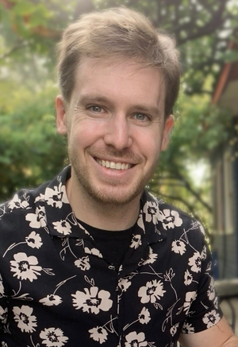

# Tom Sloan

Payload Sensor Specialist at NRC Aerospace, based in Nepean, Ontario, Canada.

<div align="center">
  
</div>

## About

I integrate sensors into autonomous systems and build the software that makes their data usable. I'm a Payload Sensor Specialist at the National Research Council Canada's Aerospace Research Centre, where I integrate and test sensor payloads on NRC aircraft, including drones, as the Centre expands into full-scale aircraft autonomy.

I finished my MASc at Carleton, where I built a drone-based indoor mapping system. I calibrated and flight-tested the camera payload on a DJI Mini 3, designed a Docker and RabbitMQ pipeline that synchronizes sensor data and streams it to the cloud for 3D reconstruction, and benchmarked neural SLAM against visual-inertial methods, reaching 6.61 cm RMSE at 21 FPS on the Replica benchmark. The work led to three IEEE papers: ICCE 2026, I2MTC 2025 and SAS 2025.

Before NRC, I worked on multi-sensor health monitoring at SAM3, using thermal cameras, pressure mats and IoT sensor nodes, and on PCB sensor arrays at Carleton. I also did DevOps at Magnet Forensics, where I moved build infrastructure to AWS, and built satellite spectrum analysis tooling at Telesat.

On my own time, I build AI-native. I use coding agents throughout research, design, implementation, testing and review, and I often run several in parallel to explore different approaches and check each other's work. I set the direction and verify the results against real hardware. Current projects include a 6-DOF robot arm trained with imitation learning in NVIDIA Isaac Sim, PixelBar, and Crier, an iOS app that turns written content into audio.

## Education

**Master of Applied Science - MASc**
Carleton University
Artificial Intelligence
January 2024 - November 2025

Thesis: Indoor 3D Modeling Using Consumer Drones and Neural Simultaneous Localization and Mapping (SLAM) for Virtual Reality and a Cloud Architecture.

**Bachelor of Engineering - BE**
Carleton University
Computer Systems Engineering
September 2017 - December 2021
Graduated with distinction

## Experience

**Payload Sensor Specialist**
National Research Council Canada
July 2026 - Present

I integrate and test sensor payloads on NRC aircraft, including drones, to support full-scale aircraft autonomy. The work covers sensor characterization and calibration, alignment and geo-referencing, and synchronized multi-sensor data acquisition.

**Machine Learning Researcher**
SAM3
November 2025 - July 2026

Integrated and calibrated multi-modal sensors (pressure mats, thermal cameras, contact sensors) for real-time health monitoring in the AGE-WELL envisAGE study. Built time-series classification pipelines that synchronize data streams from distributed IoT sensor nodes, with cross-sensor alignment and metadata tagging. Presented multi-sensor exploratory analysis to clinical stakeholders, informing study design and sensor placement.

**Research Assistant**
Carleton University
October 2023 - November 2025

Integrated and flight-tested a sensor payload on a DJI Mini 3 drone: configured the camera, performed intrinsic and extrinsic calibration, and aligned sensor reference frames for cloud-based SLAM. Designed a modular cloud architecture (Docker, RabbitMQ, React) for real-time data acquisition, synchronization, and 3D reconstruction streamed to AR headsets. Benchmarked transformer-based neural SLAM against traditional visual-inertial approaches, reaching 6.61 cm RMSE at 21 FPS on the Replica benchmark. Co-authored three IEEE papers and presented at ICCE 2026 in Dubai.

**DevOps Engineer**
Magnet Forensics
April 2022 - June 2023

Maintained CI/CD infrastructure handling 2,000+ builds a day across 30+ Jenkins nodes, with Python and PowerShell automation. Helped migrate on-premises build systems to AWS using CloudFormation and EC2. Built and maintained a React and C# dashboard with a teammate so other development teams could track the status of their builds.

**Researcher**
Carleton University
May 2018 - December 2021

Undergraduate researcher in Dr. Rafik Goubran's lab, supported by an NSERC Undergraduate Student Research Award. Designed and built hardware for non-invasive health monitoring of older adults, including PCB-based sensor arrays for heart rate, respiration rate, and body fluid flow. Wrote data acquisition and analysis software in MATLAB, Python, and C/C++. Built Bluetooth and Wi-Fi IoT devices with iOS and Android control apps.

**Spectrum Engineering Intern**
Telesat
May 2020 - December 2020

Built a Python interface and API to MATLAB so the team could work directly with operators' satellite XML data without costly MATLAB toolbox add-ons. Wrote tests and analysis code for satellite spectrum use, automating ITU regulatory compliance checks for spectrum allocation.

**Earlier roles**
Aquafitness Instructor, City of Ottawa (June 2016 - December 2017)
Lifeguard and Swimming Instructor, City of Ottawa (September 2015 - December 2017)
Lifeguard, Carleton University (May 2015 - December 2015)

## Technical Skills

**Sensor Integration & Autonomy:** Sensor Integration, Camera Calibration, Georeferencing, Data Acquisition, Flight Test, UAV, Drone Mapping, 3D Reconstruction, LiDAR

**Programming Languages:** Python, C/C++, MATLAB, JavaScript/TypeScript, Rust, SQL

**AI & Computer Vision:** PyTorch, TensorFlow, OpenCV, SLAM, Machine Learning, AI Agents

**Cloud & DevOps:** AWS, Docker, Jenkins, Linux, Git, Build Automation

**Robotics & Embedded:** ROS / ROS 2, NVIDIA Isaac Sim, RTOS, Bluetooth / BLE, PCB Design, Arduino

**Web Development:** React.js, Node.js, HTML/CSS, Front-End Development

## Certifications

Current:

-   Small Remotely Piloted Aircraft (VLOS) - Basic operations, Transport Canada (issued March 2026)
-   AWS Certified Machine Learning Engineer - Associate (issued November 2025, expires November 2028)
-   Canadian Securities Course, Canadian Securities Institute (issued August 2018)

Expired:

-   AWS Certified Security - Specialty (issued October 2022, expired October 2025)
-   AWS SysOps Administrator - Associate (issued May 2022, expired May 2025)
-   AWS Developer - Associate (issued February 2022, expired February 2025)
-   AWS Solutions Architect - Associate (issued January 2022, expired January 2025)
-   AWS Certified Cloud Practitioner (issued July 2020, expired May 2025)

## MCP Server Integration

This portfolio includes a Model Context Protocol (MCP) server written in TypeScript that provides AI assistants like Claude Desktop with structured access to portfolio data.

**What it does:**
- Exposes portfolio resources (profile, projects, experience, skills, education, certifications)
- Provides tools to search projects, filter experience, and query skills
- Fetches live data from the deployed website
- Uses Zod for runtime schema validation

**Architecture:**
- `mcp-core.ts` - Shared logic (tools, resources, data fetching)
- `mcp-server-stdio.ts` - Stdio transport for Claude Desktop (local)
- `netlify/functions/mcp-server-http.ts` - HTTP transport for remote access (in progress)

**Setup for Claude Desktop:**

1. Build the TypeScript: `npm run build`

2. Add to `~/Library/Application Support/Claude/claude_desktop_config.json`:
```json
{
  "mcpServers": {
    "tom-sloan-portfolio": {
      "command": "node",
      "args": ["/absolute/path/to/Portfolio-Website/dist/mcp-server-stdio.js"]
    }
  }
}
```

3. Restart Claude Desktop

After setup, you can ask questions like:
- "What projects has Tom worked on with Python?"
- "Show me Tom's AWS experience"
- "What are Tom's AI-related skills?"

## Connect

-   Portfolio: [tom-sloan.com](https://tom-sloan.com)
-   LinkedIn: [linkedin.com/in/tom-sloan](https://www.linkedin.com/in/tom-sloan)
-   GitHub: [github.com/Tom-Sloan](https://github.com/Tom-Sloan)
